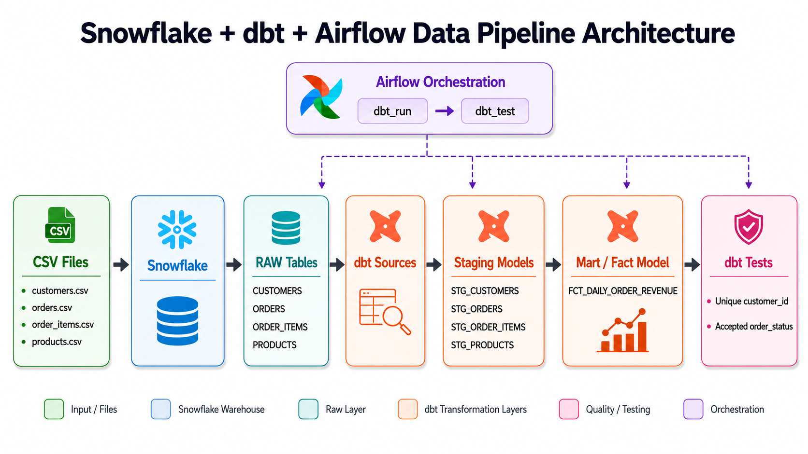
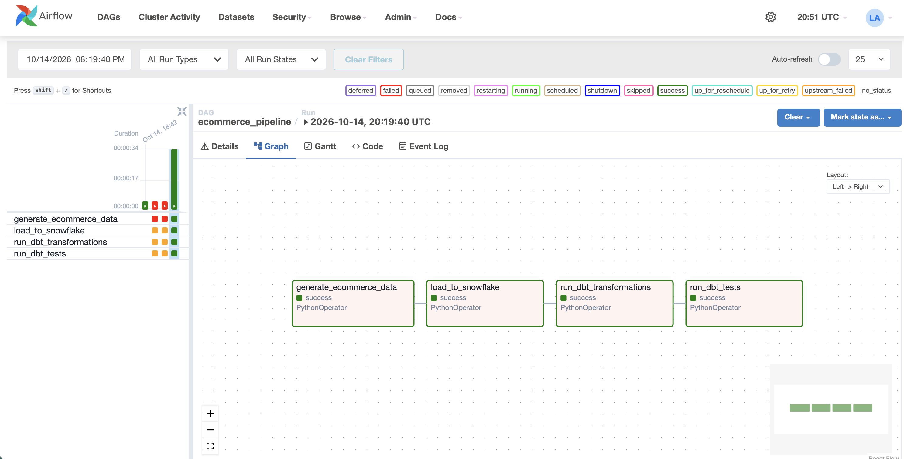
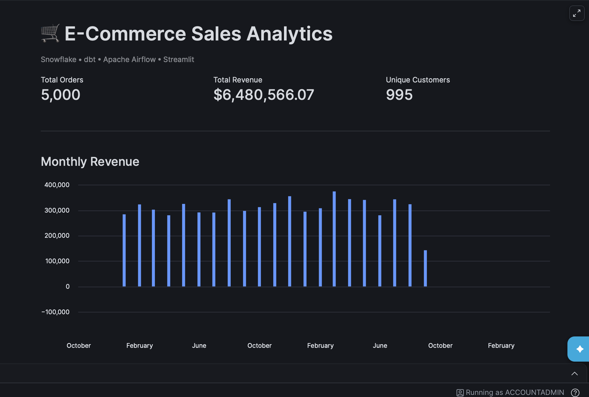

# E-Commerce Analytics Pipeline

An end-to-end data engineering project using Python, Apache Airflow, Docker, Snowflake, dbt, and Streamlit.

## Overview

This project generates synthetic e-commerce data, loads it into Snowflake, transforms it using dbt, validates data quality, and visualizes sales analytics through an interactive Streamlit dashboard.

## Tech Stack

- Python and Pandas — data generation and ingestion
- Apache Airflow — workflow orchestration
- Docker Compose — containerized infrastructure
- Snowflake — cloud data warehouse
- dbt Core — SQL transformations and data testing
- Streamlit in Snowflake — analytics dashboard
- Git and GitHub — version control

## Architecture Overview

The pipeline uses Python for data generation and ingestion,
Snowflake for cloud data warehousing, dbt for SQL
transformations and data quality testing, and Apache
Airflow for workflow orchestration.

Streamlit provides interactive sales analytics, while
GitHub Actions validates code changes.



## Pipeline Architecture

```text
Python Data Generator
        |
        v
CSV Files (Customers, Products, Orders, Order Items)
        |
        v
Snowflake RAW Schema
        |
        v
dbt STAGING Models
        |
        v
dbt MARTS Models
        |
        v
Streamlit Analytics Dashboard
```

Apache Airflow orchestrates data generation, Snowflake ingestion, dbt transformations, and dbt tests.

## Dataset

| Dataset | Rows |
|---|---:|
| Customers | 1,000 |
| Products | 200 |
| Orders | 5,000 |
| Order Items | 12,458 |

## Data Warehouse

Database: `ECOMMERCE_DB`

Schemas:
- `RAW` — source data
- `STAGING` — cleaned and standardized data
- `MARTS` — analytics-ready dimension and fact models

Key marts:
- `DIM_CUSTOMERS`
- `DIM_PRODUCTS`
- `FCT_ORDERS`
- `FCT_ORDER_ITEMS`

## Airflow Workflow

The `ecommerce_pipeline` DAG executes four tasks in sequence:

1. `generate_ecommerce_data`
2. `load_to_snowflake`
3. `run_dbt_transformations`
4. `run_dbt_tests`

The complete workflow has been successfully executed in Docker.

## Analytics Dashboard

A Streamlit application running in Snowflake provides sales analytics, including:

- Total orders
- Total revenue
- Unique customers
- Monthly revenue trends
- Date-based filtering

Example results from the generated dataset:

| Metric | Value |
|---|---:|
| Total Orders | 5,000 |
| Total Revenue | $6,480,566.07 |
| Unique Customers | 995 |

These figures are based on synthetic demonstration data.

## Project Structure

```text
snowflake-dbt-airflow-analytics-pipeline/
├── airflow/
│   └── dags/
│       └── ecommerce_pipeline.py
├── data/
│   └── raw/
├── ecommerce_dbt/
│   └── models/
│       ├── staging/
│       └── marts/
├── scripts/
│   ├── generate_ecommerce_data.py
│   └── load_to_snowflake.py
├── docker-compose.yml
├── Dockerfile
└── README.md
```

## Running the Pipeline

Prerequisites:
- Docker Desktop
- A Snowflake account
- Snowflake database, schemas, warehouse, and appropriate permissions
- Snowflake credentials configured locally

Start Airflow:

```bash
docker compose up -d
```

Open the Airflow web interface and trigger the `ecommerce_pipeline` DAG.

After successful execution, inspect the transformed tables in Snowflake and open the Streamlit analytics application.

## Security

Snowflake credentials and local environment files must not be committed to GitHub. Use local environment variables or securely managed credentials.

## Project Status

- [x] Synthetic data generation
- [x] Snowflake ingestion
- [x] dbt staging and marts
- [x] Airflow orchestration
- [x] dbt data quality tests
- [x] Streamlit analytics dashboard

## Future Enhancements

- Incremental data loading
- Automated CI/CD checks
- Advanced data quality monitoring
- Additional business intelligence metrics

## Project Screenshots

### Apache Airflow — Successful Pipeline Execution

All four tasks completed successfully: data generation, Snowflake ingestion, dbt transformations, and dbt tests.



### Streamlit — E-Commerce Analytics Dashboard

Interactive sales analytics dashboard powered by transformed Snowflake data.


